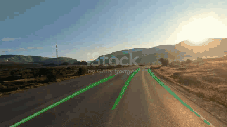
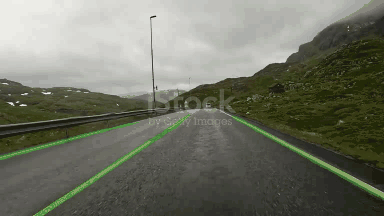
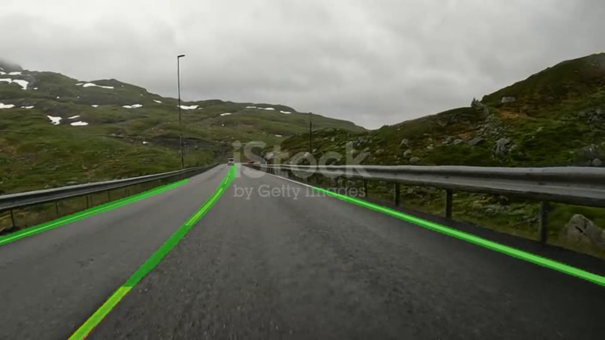
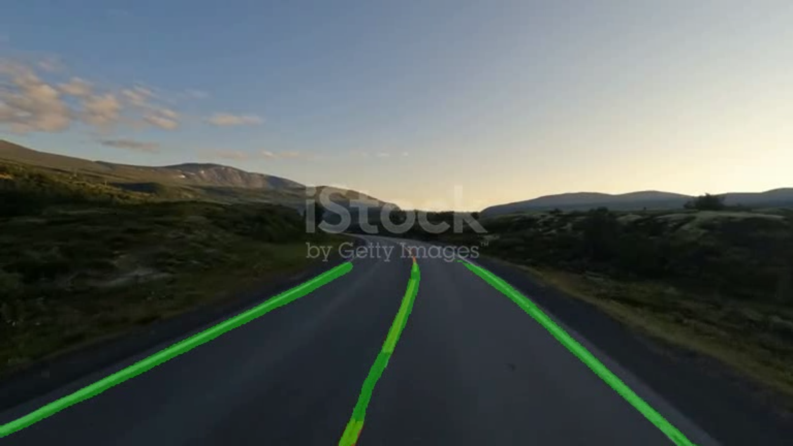
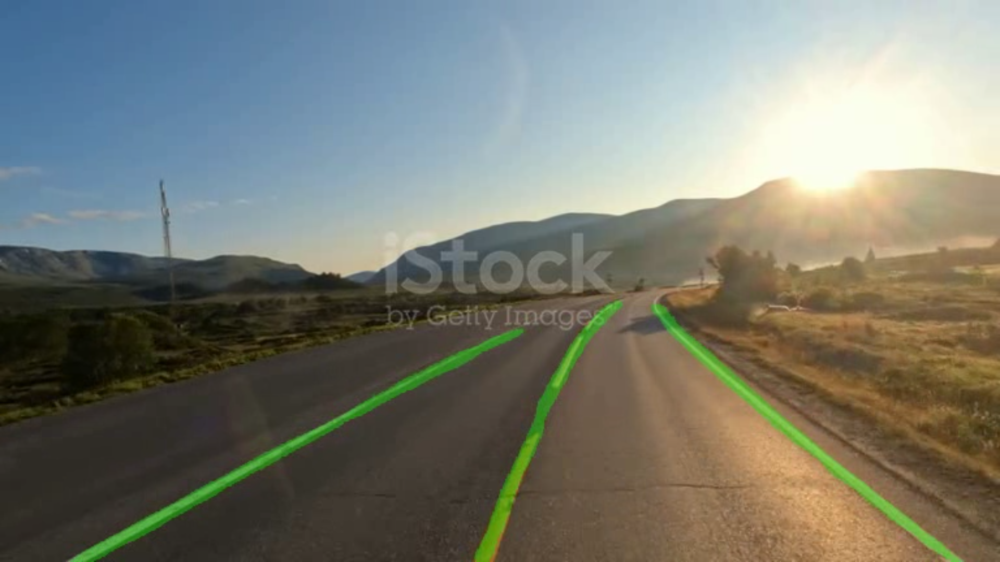

# Lane Segmentation

Pixel-level lane segmentation on driving video. A DeepLabV3+ head is trained in TensorFlow/Keras on an ImageNet ResNet50 encoder, then exported to ONNX and run on video with ONNX Runtime on CUDA.

## Result

<table>
  <tr>
    <td width="50%"></td>
    <td width="50%"></td>
  </tr>
</table>

<p>
  
  
  
</p>

Best stage-1 checkpoint, epoch 14 of a 20-epoch run, from `train_stage1.ipynb`:

| Metric | Training | Validation |
| --- | ---: | ---: |
| Loss | 0.052005 | 0.082236 |
| Pixel accuracy | 0.9887 | 0.9790 |
| Dice | 0.9080 | 0.8650 |
| Mean IoU | 0.8574 | 0.7969 |

Epoch 20 ended at validation Mean IoU 0.7884 and validation loss 0.088106. The checkpoint callback restored epoch 14.

The saved notebook output also starts a second run that unfreezes the last 11 backbone layers. That log stops early in its second epoch. Epoch 1 of that run reached validation Mean IoU 0.7946, which is below 0.7969. `export_onnx.py` loads `bestmodel.keras`, the stage-1 file saved by the checkpoint callback.

## Model files

`bestmodel.keras` and `deeplabv3plus_resnet50.onnx` are required in the project root. Both are matched by `.gitignore`, so a new clone does not contain them.

| File | Used by | Download |
| --- | --- | --- |
| `bestmodel.keras` | `export_onnx.py` | [Google Drive](https://drive.google.com/file/d/1cm036kcJNxYr6nICo83tS9Grb5batw-V/view?usp=drive_link) |
| `deeplabv3plus_resnet50.onnx` | `main.py` | [Google Drive](https://drive.google.com/file/d/1latOJ9iuqIE43wdEtRXDhdJP2BLKj7kq/view?usp=drive_link) |

Download the ONNX file to run video inference. Download the Keras file only to export again.

## Training

`train_stage1.ipynb` loads images and binary masks from a Google Drive folder, `/content/drive/MyDrive/unified`, laid out as `frames/` and `lane-masks/`. That dataset is not in this repository.

Frames that share a sequence stay on the same side of the split. `train_test_split` holds out 15% of sequence groups with `random_state=42`.

- Input size 640×640, batch size 8, two classes (background and lane).
- ResNet50 ImageNet preprocessing (caffe mode).
- Stage 1 freezes backbone layers whose names start with `conv1`, `conv2`, `conv3`, `conv4`, or `pool1`, and trains for 20 epochs.
- Loss is focal loss (`alpha=0.25`, `gamma=2.0`) plus `0.5 * Dice`.
- AdamW starts at learning rate `2e-4` with weight decay `1e-4`.
- The encoder uses ResNet50 through `conv4_block6_out`, then three custom dilated residual blocks (dilation 2) at 2048 channels. ASPP uses dilation rates 6, 12, and 18, plus global average pooling. A skip comes from `conv2_block3_out` at 48 channels. Dropout is 0.2 after ASPP and 0.1 in the decoder.

## Run

Requirements: Docker, an NVIDIA GPU, a driver that works with CUDA 12.8, and the NVIDIA Container Toolkit. `main.py` stops if `CUDAExecutionProvider` is not active. Video arguments must be filenames inside the mounted project folder, not paths.

Place `deeplabv3plus_resnet50.onnx` and the input video in this folder, then build and run.

Linux or macOS:

```bash
docker build -t lane-segment .
docker run --rm --gpus all -v "$PWD:/data" lane-segment video1.mp4 output.mp4
```

Windows PowerShell:

```powershell
docker build -t lane-segment .
docker run --rm --gpus all -v "${PWD}:/data" lane-segment video1.mp4 output.mp4
```

To export ONNX from `bestmodel.keras`, GPU is not required:

```bash
docker run --rm -v "$PWD:/data" --entrypoint python3 lane-segment /app/export_onnx.py
```

```powershell
docker run --rm -v "${PWD}:/data" --entrypoint python3 lane-segment /app/export_onnx.py
```

The exporter writes `deeplabv3plus_resnet50.onnx` at opset 17 and checks it with `onnx.checker`. The exported input layout is NHWC, `[batch, 640, 640, 3]`. `main.py` also accepts NCHW if the model input has channels in dimension 1.

## Project files

| File | Purpose |
| --- | --- |
| `train_stage1.ipynb` | Dataset split, model, and stage-1 training |
| `export_onnx.py` | Keras to ONNX |
| `main.py` | CUDA video inference and green lane overlay |
| `Dockerfile` | Image for export and inference |
| `video1.gif`, `video2.gif` | Animated previews |
| `video1.mp4`, `video2.mp4`, `video3.mp4` | Sample inference videos |
| `1.png`, `2.png`, `3.png` | Sample stills |

## Limits

- The published validation number is from the frozen-backbone run. The partial unfreeze in the notebook log did not produce a higher saved Mean IoU.
- Inference requires CUDA. There is no CPU fallback.
- The training set is external and the notebook paths point at Google Drive.
